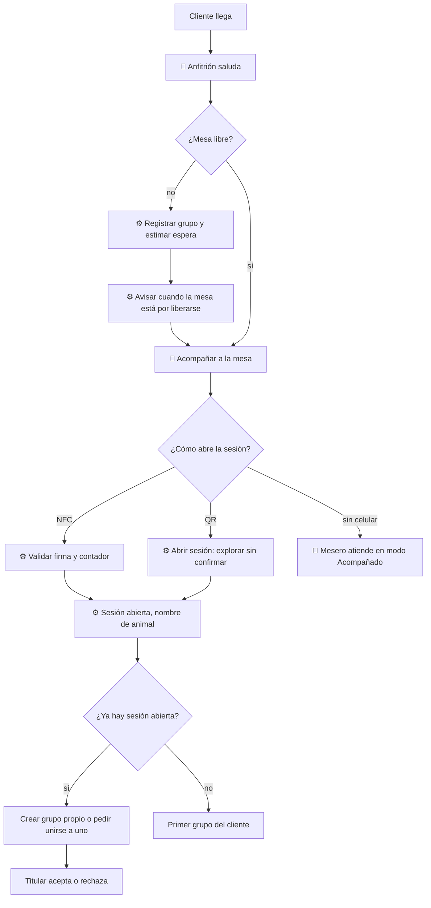

# 01 — Llegada y acceso

## Objetivo
Recibir al grupo con calidez, asignarle mesa rápido y dejar que abra la sesión de la mesa con un toque, sin perder el saludo humano.

## Actores
Cliente, anfitrión, mesero, sistema (lista de espera y sesión de mesa).

## Diagrama

## Qué automatiza la tecnología
- Registro del grupo, estimación de espera y aviso al cliente, si el local tiene Recepción y reservas. (R22)
- Apertura de la sesión por NFC con validación de firma, o por QR. (R1)
- Asignación de nombre de animal anónimo y creación del grupo. (R2)
- Solicitud de unión de quien llega a una mesa ya abierta; el grupo decide. (R3)

## Dónde el humano es obligatorio
- Saludo y primera impresión; acompañar a la mesa.
- Sobreescribir la mesa sugerida y priorizar casos especiales.
- Atender a quien no tiene celular o prefiere no usarlo. (R16)
- Expulsar a un participante no deseado. (R8)

## Señales digitales / IoT
- Sticker NFC NTAG 424 DNA (SDM) y QR por mesa. Detalle en [acceso a la mesa](../acceso-a-la-mesa.md).
- Estado de la mesa (libre, abierta, por limpiar).

## Fallas y excepciones
- NFC inválido o repetido: se ofrece el QR o llamar al mesero. (R1)
- Sin celular, sin NFC o sin red: el mesero atiende como en modo Acompañado, con comanda en papel si hace falta. (R15, R16)
- Alguien se une sin ser invitado: el titular puede rechazarlo y el mesero expulsarlo. (R3, R8)

## Métricas de calidad
Tiempo de espera real vs. estimado, tiempo hasta el saludo, proporción de aperturas por NFC vs. QR, aperturas rechazadas.

## Módulos que toca
Sala; Mesa digital (NFC/QR, grupos); Recepción y reservas (lista de espera); Personal (zonas asignadas).
