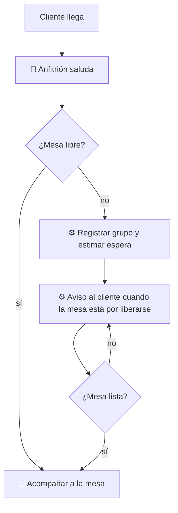

# 01 — Llegada y espera

## Objetivo
Recibir al grupo con calidez, asignarle mesa rápido y hacer la espera tolerable sin que el cliente deba quedarse parado.

## Actores
Cliente, anfitrión, sistema de lista de espera, personal de sala.

## Diagrama

## Qué automatiza la tecnología
- Registro del grupo y estimación de espera con base en ocupación real. (R1)
- Aviso al cliente (mensaje o localizador) para que no espere en la puerta. (R1)
- Sugerencia de mesa óptima según tamaño del grupo y estado de mesas. (R2)

## Dónde el humano es obligatorio
- Saludo y primera impresión.
- Decidir excepciones: sobreescribir la mesa sugerida, priorizar adultos mayores o reservaciones.
- Acompañar a la mesa y ofrecer opciones si la espera es larga.

## Señales digitales / IoT
- Estado de mesas (libre, ocupada, por cobrar), idealmente por sensor o marcado de mesero.
- Localizador o notificación al cliente.

## Fallas y excepciones
- Cliente sin celular: localizador o aviso en persona. (R9)
- Red caída: lista en papel; se captura después. (R8)
- Estimación errónea: el anfitrión corrige y se registra la desviación.

## Métricas de calidad
Tiempo de espera real vs. estimado, tiempo hasta el saludo, abandonos en espera.

## Módulos que toca
Atención al cliente; Personal (zonas asignadas).
