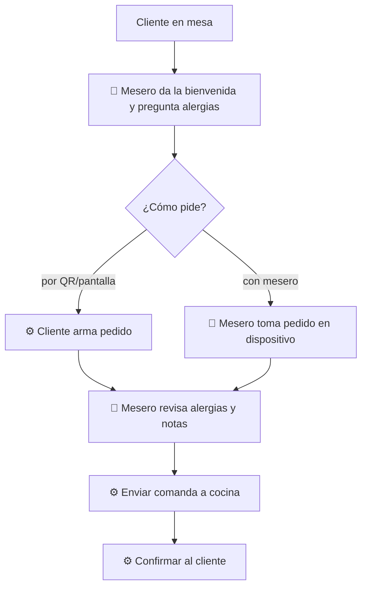

# 02 — Mesa y pedido

## Objetivo
Que el cliente pida sin esperas ni errores, con las alergias siempre atendidas, y que el mesero invierta su tiempo en recomendar, no en anotar.

## Actores
Cliente, mesero, cocina, sistema.

## Diagrama

## Qué automatiza la tecnología
- Menú digital con disponibilidad actualizada (ítems agotados ocultos). (R3)
- Captura del pedido por el cliente o el mesero y envío directo a cocina sin transcripción. (R3, R4)
- Confirmación del pedido al cliente. (R4)

## Dónde el humano es obligatorio
- Bienvenida, recomendaciones y consulta de alergias.
- Revisión humana de todo pedido con alergias o notas antes de enviarlo. (R3)
- Atender al cliente que prefiere pedir hablando. (R9)

## Señales digitales / IoT
- QR o pantalla de mesa; dispositivo del mesero; impresora o pantalla en cocina.

## Fallas y excepciones
- Sin red: comanda en papel, reconciliación posterior. (R8)
- Ítem agotado después de pedir: el mesero avisa y propone alternativa.
- Pedido ambiguo: cocina devuelve consulta al mesero, no al cliente.

## Métricas de calidad
Tiempo hasta primer contacto, errores de comanda, incidentes de alergias (meta: cero), proporción de pedidos por cada canal.

## Módulos que toca
Atención al cliente; Cocina (comanda); Inventario (disponibilidad).
