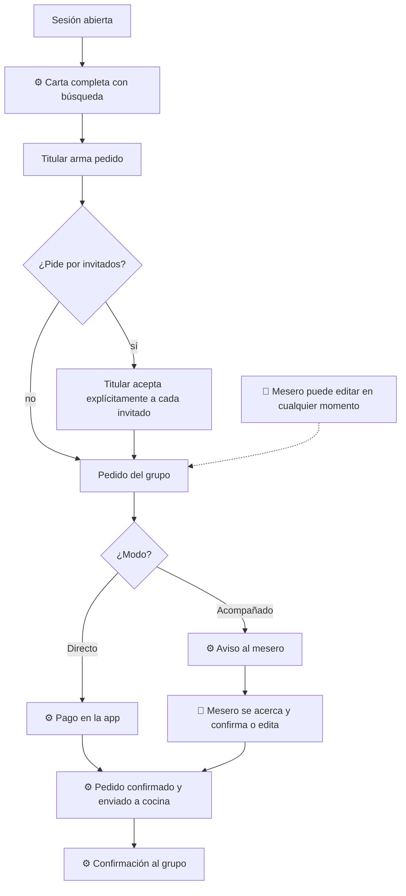

# 02 — Mesa y pedido

## Objetivo
Que cada grupo arme su pedido con autonomía, sin errores y con las alergias siempre revisadas, y que el mesero use su tiempo en recomendar, no en anotar. El camino depende del [modo de servicio](../modos-de-servicio.md).

## Actores
Titular, invitados vinculados, mesero, cocina, sistema.

## Diagrama

## Qué automatiza la tecnología
- Carta completa con búsqueda, disponibilidad actualizada y filtros. (R4)
- Pedido por grupo, con invitados vinculados cargados a la cuenta del titular. (R3, R5)
- **Directo:** el pago confirma el pedido y lo envía a cocina. (R6)
- **Acompañado:** aviso al mesero cuando el grupo está listo. (R7)
- Si el QR abrió la sesión, la confirmación (pago o mesero) es la barrera. (R1)
- Carta y textos en español e inglés. (R17)
- Autodeclaración de mayoría de edad al pedir alcohol. (R20)

## Dónde el humano es obligatorio
- Revisar alergias y notas antes de que el pedido avance, en ambos modos. (R5)
- Confirmar el pedido en modo Acompañado y recomendar. (R7)
- Editar pedidos cuando haga falta; el mesero puede hacerlo siempre. (R8)
- Atender a quien prefiere pedir hablando. (R16)
- El titular debe aceptar a cada invitado de forma explícita; no es automático. (R3)

## Señales digitales / IoT
- PWA de la sesión; dispositivo del mesero; pantalla de cocina (KDS) con impresora de comandas de respaldo.

## Fallas y excepciones
- Sin red: router 4G de respaldo; si no basta, comanda en papel y reconciliación posterior. (R15)
- Ítem agotado después de pedir: el mesero avisa y propone alternativa; en Directo el monto queda como saldo a favor. (R18)
- Pedido por QR en Directo: aviso al mesero de la zona (activado por defecto); puede cancelar y el monto queda como saldo a favor. (R1, R18)
- Dudas sobre la edad al pedir alcohol: el mesero verifica al entregar y puede cancelar el ítem. (R20)
- Pedido ambiguo: cocina consulta al mesero, no al cliente.

## Métricas de calidad
Tiempo hasta el primer pedido, errores de comanda, incidentes de alergias (meta: cero), edición de pedidos por mesero, proporción de pedidos por modo.

## Módulos que toca
Sala (pedido, revisión de alergias, confirmación); Mesa digital (carta y pedido en la PWA); Núcleo (carta); Cocina (comanda); Inventario (disponibilidad); Pagos y comprobantes (modo Directo).
