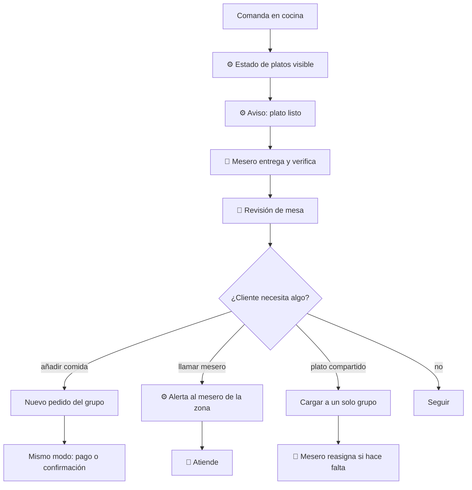

# 03 — Servicio

## Objetivo
Mantener la mesa atendida durante la comida: platos a tiempo, adiciones sin fricción, llamados respondidos y cuentas claras entre grupos.

## Actores
Titulares, invitados, mesero, cocina, sistema.

## Diagrama

## Qué automatiza la tecnología
- Seguimiento de estado de cada plato y aviso de "listo" al mesero. (R4)
- Adiciones en cualquier momento: cada una genera un nuevo flujo de pago (Directo) o se suma a la cuenta (Acompañado). (R9)
- Llamado al mesero con motivo (duda, problema, cuenta, pagar en físico, otro), ruteado al mesero de la zona. (R9)
- Alerta si un plato supera el tiempo esperado. (R4)

## Dónde el humano es obligatorio
- Entregar y confirmar el plato correcto, en especial con alergias. (R5)
- Revisión de mesa y trato; la tecnología no sustituye estar atento.
- Resolver problemas (plato frío, error) y mover ítems entre grupos. (R8, R10)
- Reasignar un plato compartido a otro grupo si hace falta. (R10)

## Señales digitales / IoT
- Botón de llamado en la sesión, notificación en el dispositivo del mesero, estado de cocina.

## Fallas y excepciones
- Llamado sin respuesta: escala al siguiente mesero tras un tiempo. (R9)
- Sin red: el mesero recorre su zona y cocina avisa a voz. (R15)
- Cliente sin celular o que no quiere usarlo: ronda de mesero normal. (R16)
- Plato compartido pedido por dos grupos: el sistema pide elegir un solo grupo; el mesero decide si hay duda. (R10)

## Métricas de calidad
Tiempo de respuesta a llamados, tiempo plato listo → mesa, adiciones por visita, quejas durante el servicio.

## Módulos que toca
Atención al cliente; Cocina (estados); Personal (zonas y alertas); Pagos y comprobantes (adiciones).
