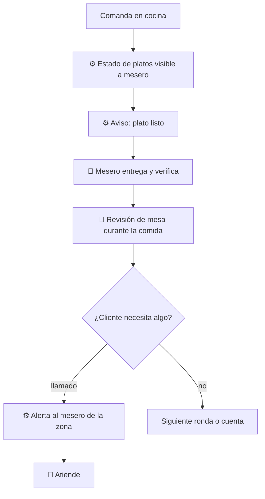

# 03 — Servicio

## Objetivo
Mantener la mesa atendida durante la comida: platos a tiempo, llamados respondidos y cero fricción para pedir algo más.

## Actores
Cliente, mesero, cocina, sistema.

## Diagrama

## Qué automatiza la tecnología
- Seguimiento de estado de cada plato y aviso de "listo" al mesero. (R4)
- Llamado por botón de mesa o app, ruteado al mesero de esa zona. (R5)
- Alerta si un plato supera el tiempo esperado. (R4)

## Dónde el humano es obligatorio
- Entrega a la mesa y confirmación del plato correcto, en especial con alergias.
- Revisión de mesa y trato durante la comida: la tecnología no sustituye estar atento.
- Resolver problemas (plato frío, error): decide una persona.

## Señales digitales / IoT
- Botón de llamado en mesa; notificación en dispositivo del mesero; estado de cocina.

## Fallas y excepciones
- Botón sin respuesta: escala al mesero siguiente tras un tiempo. (R5)
- Sin red: el mesero recorre su zona y la cocina avisa a voz. (R8)
- Cliente que no quiere botones: el mesero lo atiende con la ronda normal. (R9)

## Métricas de calidad
Tiempo de respuesta a llamados, tiempo plato listo → mesa, quejas durante el servicio.

## Módulos que toca
Atención al cliente; Cocina (estados); Personal (zonas y alertas).
