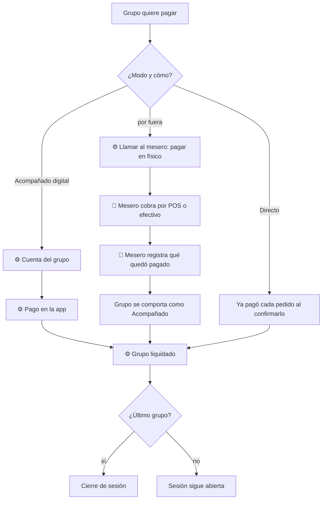

# 04 — Cuenta y pago

## Objetivo
Que cada grupo pague a su ritmo y a su manera, sin esperas ni errores, con la opción de pagar con una persona siempre disponible.

## Actores
Titular, mesero, sistema de pagos.

## Diagrama

## Qué automatiza la tecnología
- Cálculo de la cuenta del grupo desde lo realmente pedido, incluidos invitados vinculados. (R6, R7)
- **Directo:** el cobro ocurre en cada pedido; al final no queda nada por pagar salvo adiciones. (R6)
- **Acompañado:** pago digital de la cuenta al final de la visita del grupo. (R7)
- Pago por grupo, independiente de los demás. (R3)

## Dónde el humano es obligatorio
- **Pago por fuera siempre disponible:** el cliente llama al mesero, pagan por POS o efectivo y el mesero registra qué quedó pagado. (R11)
- Resolver discrepancias, cortesías, descuentos y reembolsos. (R8)
- Despedida personal; el pago digital no elimina el cierre humano. (R16)

## Señales digitales / IoT
- Pago en la app, terminal POS externo, impresora de comprobante.

## Fallas y excepciones
- Pago rechazado: el mesero ofrece alternativa con discreción. (R11)
- Sin red: cobro manual y registro posterior. (R15)
- Pedido cancelado por el mesero después de pagado en Directo: se reembolsa. (R8)
- Grupo que cambia de decisión (de digital a físico): se pasa a modo Acompañado sin perder lo ya pagado. (R11)

## Métricas de calidad
Tiempo desde pedir pagar hasta liquidar, errores de cobro, uso de cada medio, proporción de pagos por fuera, reembolsos.

## Módulos que toca
Atención al cliente; Pagos y comprobantes; Inventario (consumo cerrado); Personal (propinas, por definir).
