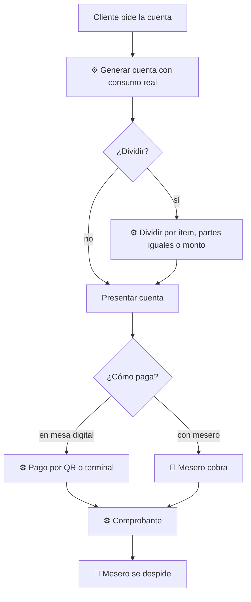

# 04 — Cuenta y pago

## Objetivo
Cobrar sin esperas ni errores, permitiendo dividir la cuenta y elegir cómo pagar, con una despedida atendida por una persona.

## Actores
Cliente, mesero, sistema de pagos.

## Diagrama

## Qué automatiza la tecnología
- Cálculo de la cuenta desde lo realmente pedido, sin transcripción. (R6)
- División flexible de la cuenta. (R6)
- Pago por QR, terminal en mesa o pago tradicional; comprobante y factura. (R6)

## Dónde el humano es obligatorio
- Presentar o ratificar la cuenta cuando hay dudas o ajustes.
- Resolver discrepancias, cortesías y descuentos.
- Despedida personal; el pago digital no elimina el cierre humano. (R6)

## Señales digitales / IoT
- Terminal de pago, QR de cuenta, impresora de comprobante.

## Fallas y excepciones
- Pago rechazado: el mesero ofrece alternativa con discreción.
- Sin red: cobro manual y registro posterior. (R8)
- Cliente prefiere efectivo o tarjeta con mesero: sin penalización. (R9)

## Métricas de calidad
Tiempo de la petición de cuenta al pago, errores de cobro, uso de cada medio, porcentaje de cuentas divididas.

## Módulos que toca
Atención al cliente; Inventario (consumo cerrado); Personal (propinas, por definir).
