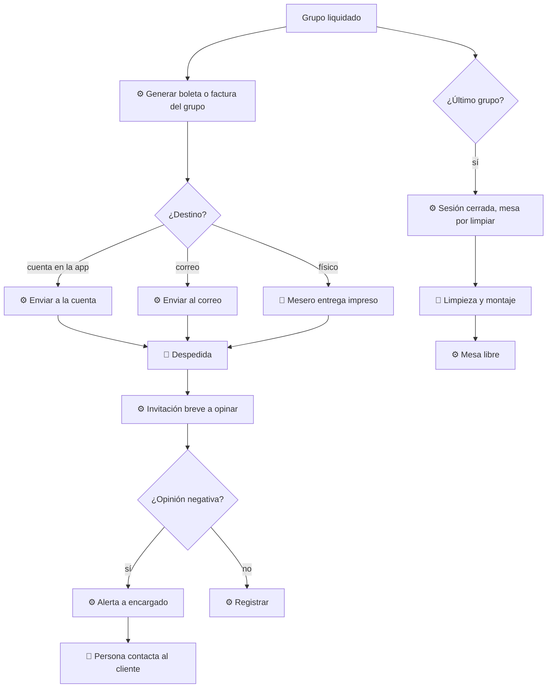

# 05 — Cierre y comprobantes

## Objetivo
Cerrar cada grupo y la sesión con buena impresión, entregar el comprobante donde el cliente prefiera, recoger opinión sin molestar y dejar la mesa lista rápido.

## Actores
Titular, mesero, sistema, encargado.

## Diagrama

## Qué automatiza la tecnología
- Boleta o factura **por grupo**, generada al liquidarse. (R12)
- Envío a la cuenta del cliente (si está inscrito), a su correo, o impresión, según indique. (R12)
- Cierre de la sesión cuando se liquida el último grupo y paso de la mesa a "por limpiar". (R13)
- Invitación breve y opcional a dejar feedback; alerta inmediata si es negativo. (R14)

## Dónde el humano es obligatorio
- Despedida y agradecimiento.
- Entregar el comprobante impreso si el cliente lo pidió. (R16)
- Responder a quejas: una persona contacta al cliente. (R14)
- Limpieza y montaje de la mesa.
- Cerrar manualmente una sesión sin consumo o con problemas. (R13)

## Señales digitales / IoT
- Envío de comprobantes, QR o mensaje de feedback, estado de mesa (por limpiar, libre).

## Fallas y excepciones
- Correo inválido o inscripción pendiente: el mesero ofrece alternativa (impreso). (R12)
- Cliente no quiere opinar: no se insiste. (R16)
- Un grupo se va y otro sigue: la sesión permanece abierta hasta el último. (R13)
- Sin red: comprobante impreso manual y envío digital al reconectar. (R15)

## Métricas de calidad
Tiempo de entrega de comprobante, tasa de respuesta de feedback, tiempo de contacto ante una queja, tiempo de rotación de mesa.

## Módulos que toca
Atención al cliente; Pagos y comprobantes; Cuenta de cliente (futuro, historial); Personal (limpieza, encargado).

## Futuro
Historial de visitas y acumulador de boletas en la interfaz del cliente. Registrado en [pagos y comprobantes](../pagos-y-comprobantes.md); no se diseña en esta fase.
