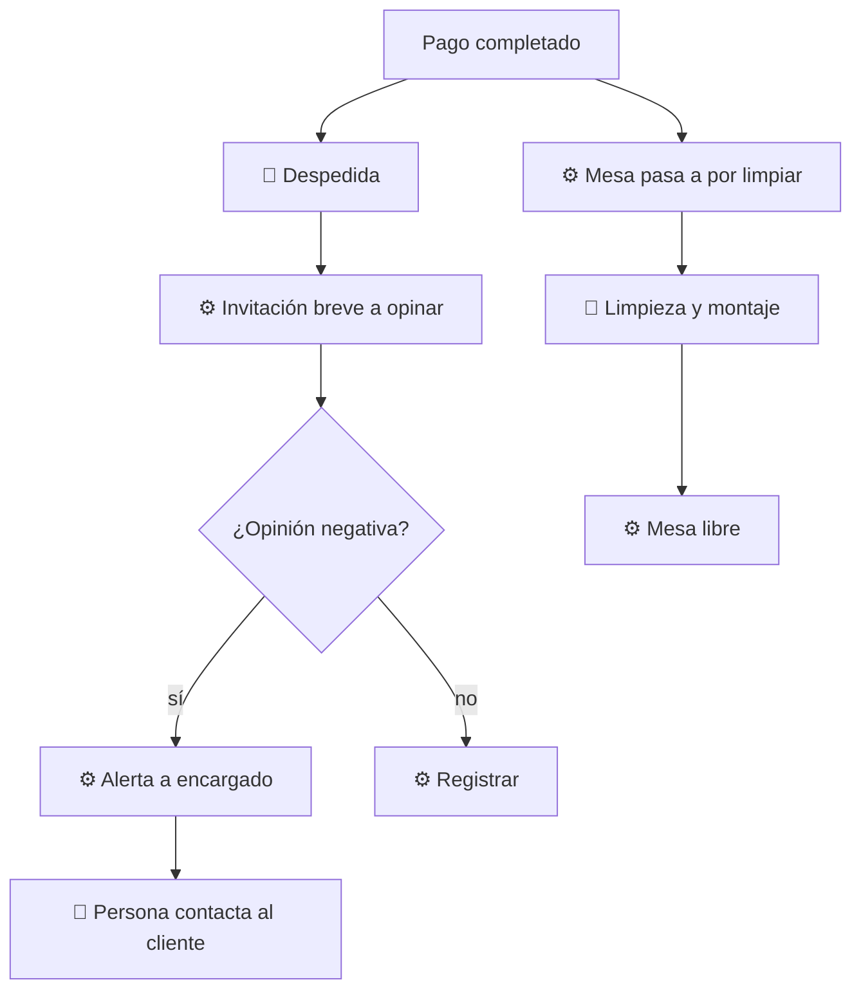

# 05 — Salida y feedback

## Objetivo
Cerrar la visita con buena impresión, recoger opinión sin molestar y dejar la mesa lista rápido.

## Actores
Cliente, anfitrión/mesero, sistema.

## Diagrama

## Qué automatiza la tecnología
- Invitación breve y opcional a dejar feedback (un par de preguntas). (R7)
- Detección de opinión negativa y alerta inmediata al encargado. (R7)
- Cambio de estado de la mesa para liberar la siguiente asignación. (R1)

## Dónde el humano es obligatorio
- Despedida y agradecimiento.
- Responder a quejas: una persona contacta al cliente, no una respuesta automática. (R7)
- Limpieza y montaje de la mesa.

## Señales digitales / IoT
- QR o mensaje de feedback; estado de mesa (por limpiar, libre).

## Fallas y excepciones
- Cliente no quiere opinar: no se insiste. (R9)
- Queja grave en persona: se atiende en el momento, el sistema solo registra.

## Métricas de calidad
Tasa de respuesta de feedback, tiempo de contacto ante una queja, tiempo de rotación de mesa.

## Módulos que toca
Atención al cliente; Personal (limpieza, encargado).
