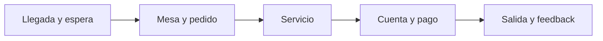

# Flujos de atención al cliente

Recorrido del cliente en cinco etapas. Cada flujo sigue la plantilla de abajo.

1. [Llegada y espera](01-llegada-y-espera.md)
2. [Mesa y pedido](02-mesa-y-pedido.md)
3. [Servicio](03-servicio.md)
4. [Cuenta y pago](04-cuenta-y-pago.md)
5. [Salida y feedback](05-salida-y-feedback.md)

## Plantilla
Cada archivo contiene, en este orden:
1. Objetivo
2. Actores (cliente, anfitrión, mesero, cocina, sistema)
3. Diagrama Mermaid
4. Qué automatiza la tecnología
5. Dónde el humano es obligatorio
6. Señales digitales / IoT
7. Fallas y excepciones
8. Métricas de calidad
9. Módulos que toca

## Convenciones
- Mermaid para diagramas; un flujo por archivo; nombres `NN-kebab-case.md` sin acentos.
- Los pasos con ⚙️ son automáticos, los marcados 🤝 son humanos obligatorios.
- Las referencias a requisitos usan los códigos R1..R9 de [atencion-cliente.md](../modulos/atencion-cliente.md).
