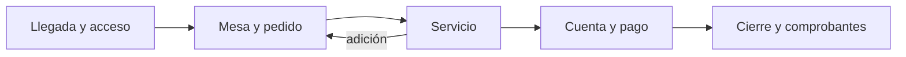

# Flujos de atención al cliente

Recorrido del cliente en cinco etapas, organizado en torno a la [sesión de mesa](../sesion-de-mesa.md) y los [modos de servicio](../modos-de-servicio.md).

1. [Llegada y acceso](01-llegada-y-acceso.md)
2. [Mesa y pedido](02-mesa-y-pedido.md)
3. [Servicio](03-servicio.md)
4. [Cuenta y pago](04-cuenta-y-pago.md)
5. [Cierre y comprobantes](05-cierre-y-comprobantes.md)

## Plantilla
Cada archivo contiene, en este orden:
1. Objetivo
2. Actores
3. Diagrama Mermaid
4. Qué automatiza la tecnología
5. Dónde el humano es obligatorio
6. Señales digitales / IoT
7. Fallas y excepciones
8. Métricas de calidad
9. Módulos que toca

## Convenciones
- Mermaid para diagramas; un flujo por archivo; nombres `NN-kebab-case.md` sin acentos.
- Los pasos con ⚙️ son automáticos, los marcados con 🤝 son humanos obligatorios.
- Las referencias a requisitos usan los códigos R1..R21 de [atencion-cliente.md](../modulos/atencion-cliente.md).
- Todo flujo debe indicar qué pasa en modo Directo y en modo Acompañado, y cómo funciona el pago por fuera.
