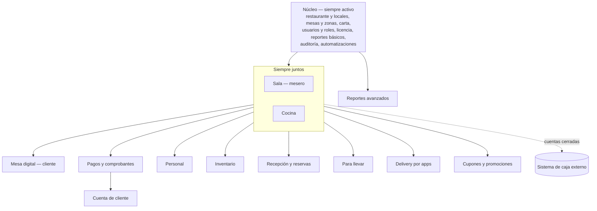
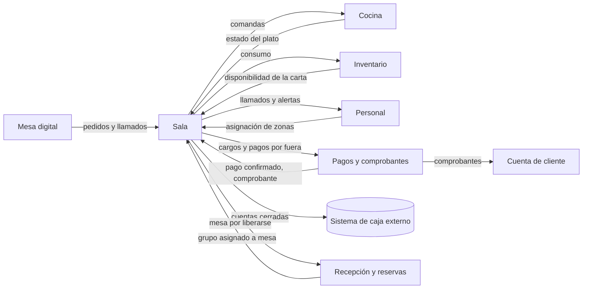

# Módulos

Hungría tiene un **Núcleo** siempre activo y **módulos** que se activan por local según la licencia ([ADR 0009](../adr/0009-licencias-y-activacion-de-modulos.md)). Los módulos se comunican solo por contratos ([ADR 0001](../adr/0001-modularidad.md)).

## Mapa

## Catálogo
| Módulo | Estado | Responsabilidad | Requiere |
|---|---|---|---|
| [Núcleo](nucleo/README.md) | fase 1, diseño | Restaurante y locales, mesas y zonas, carta, usuarios y roles, licencia, reportes básicos, auditoría, automatizaciones | — |
| [Sala](sala/README.md) | fase 1, diseño | Operación del mesero: sesión de mesa, toma de pedidos, cuenta, pago por fuera, envío de cuentas cerradas al sistema de caja | Núcleo, Cocina |
| Cocina | planeado | Comandas en pantalla (KDS) e impresora, estados por plato, estaciones | Núcleo, Sala |
| [Mesa digital](mesa-digital/README.md) | fase 1, diseño | PWA del cliente, acceso NFC/QR, grupos, modos Directo y Acompañado, feedback | Sala (Pagos para modo Directo) |
| Recepción y reservas | fase 1, diseño | Lista de espera y reservas online | Sala |
| Para llevar | planeado | Pedido y pago por enlace, recojo en el local | Sala (Pagos opcional) |
| Delivery por apps | planeado | Pedidos de apps de delivery directo a Cocina | Sala |
| Cupones y promociones | planeado | Códigos, happy hour, 2x1, por local y horario | Sala |
| Reportes avanzados | planeado | Indicadores: ticket promedio, rotación, tiempos de cocina, platos más vendidos, comparación entre locales | Núcleo |
| Pagos y comprobantes | fase 1, diseño | Pasarela del restaurante, QR o link de pago del mesero, comprobantes SUNAT, saldo a favor, propinas ([pagos](pagos/pagos-y-comprobantes.md)) | Sala |
| Personal | planeado | Turnos, asignación de zonas, alertas al mesero, reparto de propinas | Sala |
| Inventario | planeado | Existencias, consumo por plato, disponibilidad de la carta | Sala |
| Cuenta de cliente | futuro | Registro con correo, login con Google o Apple, tarjeta guardada en la pasarela, historial y comprobantes | Pagos, Mesa digital |

Los módulos planeados no tienen documento propio hasta que se aborden; sus contratos con Sala están en [sala.md](sala/README.md). Requisitos de todos los módulos: [requisitos](../plataforma/requisitos.md).

## Paquetes
Todos incluyen el Núcleo. A cualquier paquete se le pueden sumar módulos extra si cumplen sus dependencias.

| Paquete | Módulos |
|---|---|
| Mesero | Sala + Cocina |
| Mesero con cobro | Mesero + Pagos |
| Mesa digital | Mesero + Mesa digital + Pagos |
| Completo | Todos los módulos |

## Contratos entre módulos

Qué necesita cada módulo y qué pasa cuando falta un opcional: [dependencias y degradación](../plataforma/dependencias.md).
Mensajes entre módulos: [eventos y comandos](../plataforma/eventos.md).
Estados de mesa, pedido, ítem y llamado: [máquinas de estado](sala/estados.md).
Qué está hecho y qué falta en cada módulo: [mapa de avance](../roadmap.md).
