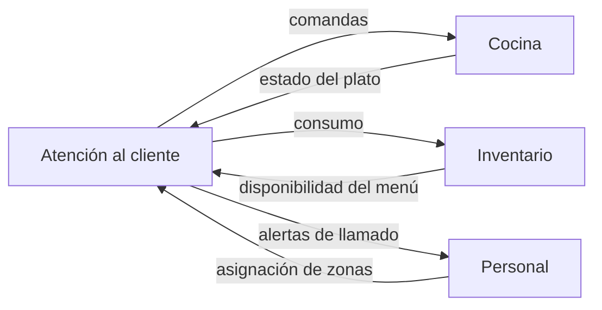

# Módulos

Hungría se compone de módulos independientes (ver [ADR 0001](../adr/0001-modularidad.md)).

| Módulo | Estado | Responsabilidad |
|---|---|---|
| [Atención al cliente](atencion-cliente.md) | fase 1, diseño | Recorrido del cliente: espera, mesa, pedido, servicio, cuenta, feedback |
| Cocina | planeado | Recibir comandas, tiempos de preparación, estaciones |
| Personal | planeado | Turnos, asignación de mesas/zonas, comunicación interna |
| Inventario | planeado | Existencias, consumo por plato, disponibilidad del menú |

Los módulos planeados no tienen documento propio hasta que se aborden; sus contratos con atención al cliente están en [atencion-cliente.md](atencion-cliente.md).

## Dependencias (contratos)

