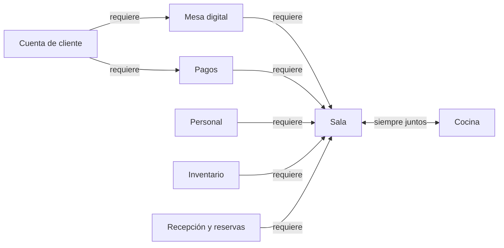

# Dependencias y degradación por módulo

Qué necesita cada módulo, qué módulos aprovecha si están activos y qué hace cuando no lo están. Base: [ADR 0009](../adr/0009-licencias-y-activacion-de-modulos.md). Catálogo y paquetes: [módulos](README.md).

## Reglas generales
- El **Núcleo** está siempre activo; ningún módulo necesita declararlo.
- Un módulo **requerido** debe estar activo en el local; si no, el módulo no se puede activar.
- Un módulo **opcional** mejora al otro si está activo. Si no lo está, se usa el comportamiento de la columna "Sin él".
- Los eventos que emite un módulo pueden no tener a nadie escuchando; quien emite no depende de quien escucha.
- Siempre hay una vía humana: la degradación nunca deja al cliente sin poder pedir ni pagar.

## Matriz
| Módulo | Requiere | Opcionales |
|---|---|---|
| Sala | Cocina | Mesa digital, Pagos, Personal, Inventario, Recepción y reservas |
| Cocina | Sala | Inventario, Personal |
| Mesa digital | Sala | Pagos, Personal, Inventario, Cuenta de cliente |
| Pagos y comprobantes | Sala | Mesa digital, Personal, Cuenta de cliente |
| Personal | Sala | Pagos |
| Inventario | Sala | — |
| Recepción y reservas | Sala | — |
| Para llevar | Sala | Pagos |
| Delivery por apps | Sala | Inventario |
| Cupones y promociones | Sala | Pagos, Mesa digital |
| Reportes avanzados | — | todos |
| Cuenta de cliente | Pagos, Mesa digital | — |

## Comportamiento sin cada opcional

### Sala
| Sin | Qué pasa |
|---|---|
| Mesa digital | El mesero toma todos los pedidos en su dispositivo. La sesión de mesa existe, pero los grupos los crea y divide el mesero. No hay NFC, QR ni PWA. |
| Pagos | Solo pago por fuera, que el mesero registra. Hungría **no emite comprobantes**; el restaurante los emite con su sistema actual. No hay saldo a favor ni propina sugerida. |
| Personal | Los llamados y alertas llegan a **todos los meseros del local**. No hay asignación por zona ni turno. |
| Inventario | La disponibilidad de la carta la marca el personal a mano (ítem agotado o disponible, en el Núcleo). |
| Recepción y reservas | No hay lista de espera digital; el anfitrión la lleva a mano y asigna la mesa en Sala. |

Sala **siempre** envía al sistema de caja cada cuenta cerrada, tenga o no Pagos ([ADR 0007](../adr/0007-ventas-al-sistema-de-caja.md)). Si Pagos está activo, el envío incluye el comprobante emitido.

### Cocina
| Sin | Qué pasa |
|---|---|
| Inventario | No descuenta existencias; solo muestra y gestiona comandas. |
| Personal | Las estaciones no tienen cocineros asignados; cualquier usuario de cocina ve todas las comandas. |

### Mesa digital
| Sin | Qué pasa |
|---|---|
| Pagos | Solo **modo Acompañado**: el cliente pide en la PWA, el mesero confirma y se paga por fuera. El modo Directo no está disponible. |
| Personal | Los llamados desde la PWA llegan a todos los meseros del local. |
| Inventario | Los ítems agotados los marca el personal a mano y la PWA los oculta. |
| Cuenta de cliente | El comprobante solo se envía por correo o impreso. No hay historial de visitas. |

### Pagos y comprobantes
| Sin | Qué pasa |
|---|---|
| Mesa digital | El cliente paga desde un **QR o link de pago** que el mesero genera en su dispositivo para el grupo (tarjeta, Yape, Plin, según la pasarela). Comprobantes, saldo a favor y propina sugerida funcionan igual. |
| Personal | Las propinas se registran por grupo, pero no se reparten entre el personal. |
| Cuenta de cliente | El comprobante solo se envía por correo o impreso. |

### Personal
| Sin | Qué pasa |
|---|---|
| Pagos | Solo reparte las propinas que el mesero registra a mano en los pagos por fuera. |

### Módulos extra
| Módulo | Sin | Qué pasa |
|---|---|---|
| Para llevar | Pagos | El cliente paga al recoger, por fuera. |
| Delivery por apps | Inventario | La disponibilidad no se sincroniza sola con las apps; el personal la marca a mano en cada app. |
| Cupones y promociones | Mesa digital | El mesero aplica el cupón en Sala. |
| Cupones y promociones | Pagos | El descuento se refleja en la cuenta y se cobra por fuera. |
| Reportes avanzados | cualquier módulo | Solo muestra indicadores de los módulos activos. |

### Inventario, Recepción y reservas, Cuenta de cliente
No tienen opcionales.

## Resumen por paquete
| Paquete | Cómo pide el cliente | Cómo paga | Comprobante |
|---|---|---|---|
| Mesero | Al mesero | Por fuera | Sistema actual del restaurante |
| Mesero con cobro | Al mesero | QR o link del mesero, o por fuera | Hungría (SUNAT vía PSE/OSE) |
| Mesa digital | PWA o mesero | PWA (Directo o Acompañado), o por fuera | Hungría |
| Completo | PWA o mesero | PWA, o por fuera | Hungría, también en la cuenta del cliente |
