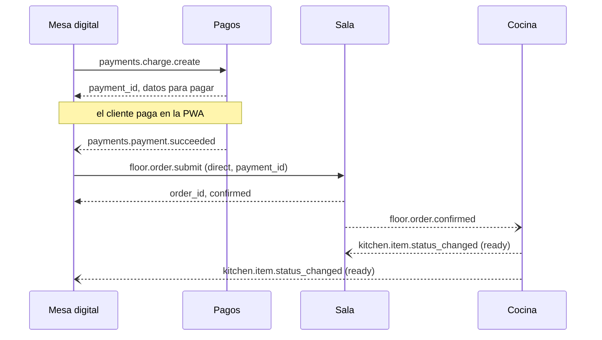
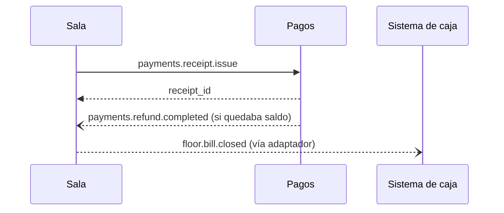

# Eventos y comandos

Catálogo de mensajes entre módulos. Reglas: [ADR 0010](../adr/0010-eventos-y-comandos.md). Los nombres y campos están en inglés porque son identificadores técnicos; las descripciones, en español.

## Prefijos de módulo
| Prefijo | Módulo |
|---|---|
| `core` | [Núcleo](nucleo.md) |
| `floor` | [Sala](sala.md) |
| `tableside` | [Mesa digital](mesa-digital.md) |
| `kitchen` | Cocina |
| `payments` | [Pagos y comprobantes](../pagos-y-comprobantes.md) |
| `staff` | Personal |
| `inventory` | Inventario |
| `reception` | Recepción y reservas |
| `customer` | Cuenta de cliente |

## Sobre común
Todo mensaje lleva:

| Campo | Descripción |
|---|---|
| `message_id` | ID único; el receptor ignora los repetidos |
| `type` | Nombre, por ejemplo `floor.session.opened` |
| `version` | Versión del mensaje |
| `occurred_at` | Fecha y hora |
| `location_id` | Local donde ocurrió |
| `actor` | Quién lo causó: usuario del personal, participante anónimo o sistema |
| `payload` | Datos propios del mensaje |

## Eventos
"Oyentes" son los módulos que reaccionan si están activos. El Núcleo (auditoría, reportes y automatizaciones) escucha todos y no se repite en la tabla.

### Núcleo (`core`)
| Evento | Datos | Oyentes |
|---|---|---|
| `core.table.status_changed` | `table_id`, `status` (free, open, to_clean) | floor, reception |
| `core.menu_item.availability_changed` | `item_id`, `available` | floor, tableside, kitchen |
| `core.menu.updated` | `menu_id` | floor, tableside, kitchen, inventory |
| `core.license.changed` | `active_modules` | todos |

### Sala (`floor`)
| Evento | Datos | Oyentes |
|---|---|---|
| `floor.session.opened` | `session_id`, `table_id`, `opened_via` (nfc, qr, waiter) | tableside, reception |
| `floor.session.merged` | `from_session_id`, `into_session_id` | tableside |
| `floor.session.closed` | `session_id`, `reason` (settled, inactivity, manual) | tableside, reception |
| `floor.group.created` | `session_id`, `group_id` | tableside |
| `floor.participant.removed` | `group_id`, `participant_id`, `reason` (expelled, moved) | tableside |
| `floor.order.confirmed` | `order_id`, `group_id`, `table_id`, `item_ids`, `has_allergy_notes` | kitchen, tableside, inventory |
| `floor.order.edited` | `order_id`, `changed_item_ids`, `reason` | kitchen, tableside |
| `floor.order.cancelled` | `order_id`, `reason` | kitchen, tableside, inventory |
| `floor.call.answered` | `call_id`, `waiter_id` | tableside, staff |
| `floor.alert.raised` | `alert_id`, `kind` (call_unanswered, dish_delayed, qr_direct_order), `table_id` | staff |
| `floor.offline_payment.recorded` | `group_id`, `amount`, `tip`, `method` (cash, card_terminal, other) | payments, staff |
| `floor.bill.closed` | `group_id`, `session_id`, `total`, `tip`, `receipt_id` (si lo hay) | inventory, customer, adaptador del sistema de caja |

### Mesa digital (`tableside`)
| Evento | Datos | Oyentes |
|---|---|---|
| `tableside.access.rejected` | `table_id`, `reason` (bad_signature, replayed_counter) | floor |
| `tableside.participant.joined` | `session_id`, `participant_id`, `animal_name` | floor |
| `tableside.join.requested` | `group_id`, `participant_id` | floor |
| `tableside.join.resolved` | `group_id`, `participant_id`, `accepted` | floor |
| `tableside.call.requested` | `call_id`, `table_id`, `group_id`, `reason` (question, problem, bill, pay_offline, other) | floor, staff |
| `tableside.feedback.submitted` | `group_id`, `score`, `negative` | floor, staff |

### Cocina (`kitchen`)
| Evento | Datos | Oyentes |
|---|---|---|
| `kitchen.ticket.received` | `ticket_id`, `order_id` | floor, tableside |
| `kitchen.item.status_changed` | `order_id`, `item_id`, `status` (preparing, ready) | floor, tableside |
| `kitchen.item.delayed` | `order_id`, `item_id`, `minutes_over` | floor, staff |

### Pagos y comprobantes (`payments`)
| Evento | Datos | Oyentes |
|---|---|---|
| `payments.payment.succeeded` | `payment_id`, `group_id`, `amount`, `tip`, `method` | floor, tableside, staff |
| `payments.payment.failed` | `payment_id`, `group_id`, `reason` | floor, tableside |
| `payments.credit.changed` | `group_id`, `balance` | floor, tableside |
| `payments.refund.completed` | `refund_id`, `group_id`, `amount` | floor, tableside |
| `payments.refund.failed` | `refund_id`, `group_id`, `amount` | floor, staff |
| `payments.receipt.issued` | `receipt_id`, `group_id`, `kind` (boleta, factura) | floor, tableside, customer |
| `payments.receipt.failed` | `group_id`, `reason` | floor |

### Personal, Inventario y Recepción
| Evento | Datos | Oyentes |
|---|---|---|
| `staff.assignment.changed` | `waiter_id`, `zone_ids`, `shift_id` | floor |
| `inventory.item.depleted` | `item_id` | core |
| `inventory.item.restocked` | `item_id` | core |
| `reception.party.waitlisted` | `party_id`, `party_size`, `estimated_wait_min` | floor |
| `reception.party.seated` | `party_id`, `table_id` | floor |

Inventario no cambia la carta por su cuenta: avisa y el Núcleo actualiza la disponibilidad, que se publica con `core.menu_item.availability_changed`.

## Comandos
Solo se envían si el módulo destino está activo en el local. Si no lo está, quien lo envía aplica la degradación de [dependencias](dependencias.md).

| Comando | Lo envía | Datos | Responde |
|---|---|---|---|
| `floor.order.submit` | tableside | `group_id`, `items`, `notes`, `mode` (direct, assisted), `payment_id` (Directo) | `order_id`, estado (pending_confirmation, confirmed) |
| `floor.session.open` | tableside, reception | `table_id`, `opened_via` | `session_id` |
| `core.menu_item.set_availability` | floor, inventory | `item_id`, `available` | ok |
| `payments.charge.create` | tableside, floor | `group_id`, `amount`, `tip` | `payment_id`, URL o datos para pagar |
| `payments.payment_link.create` | floor | `group_id`, `amount` | `payment_id`, link y QR (R23) |
| `payments.adjustment.create` | floor | `group_id`, `order_id`, `amount`, `reason` | nuevo saldo del grupo (R18) |
| `payments.receipt.issue` | floor | `group_id`, `kind`, `tax_id` (RUC, si es factura), `destination` (email, print, account) | `receipt_id` o error |
| `kitchen.ticket.reprint` | floor | `order_id` | ok |

El correo y el RUC solo viajan en `payments.receipt.issue`, que los necesita para emitir.

## Ejemplo: pedido en modo Directo

Flechas continuas: comandos con respuesta. Flechas punteadas: eventos.

## Ejemplo: cierre de un grupo con Pagos

Sin Pagos, Sala publica `floor.bill.closed` sin `receipt_id` y el comprobante lo emite el sistema actual del restaurante.
