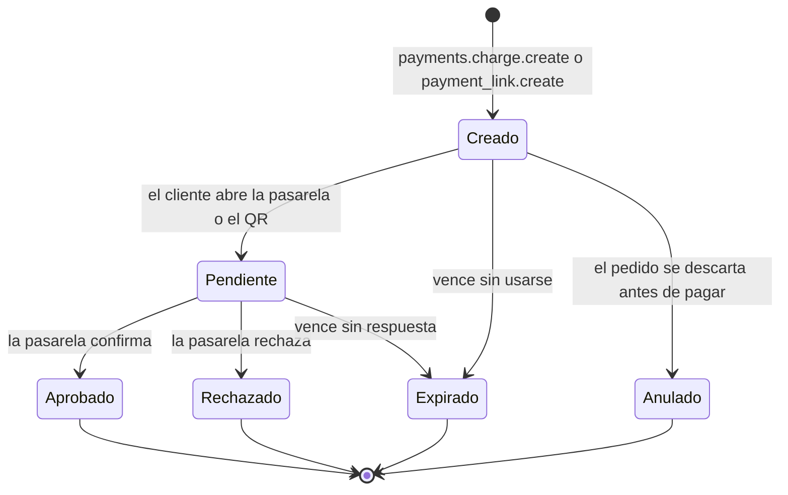
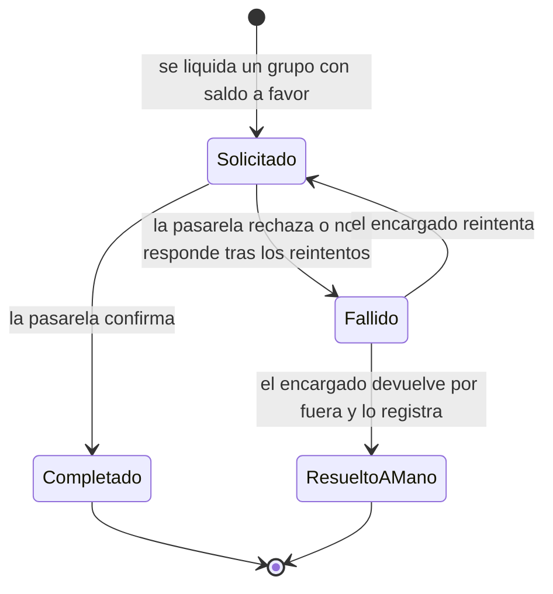
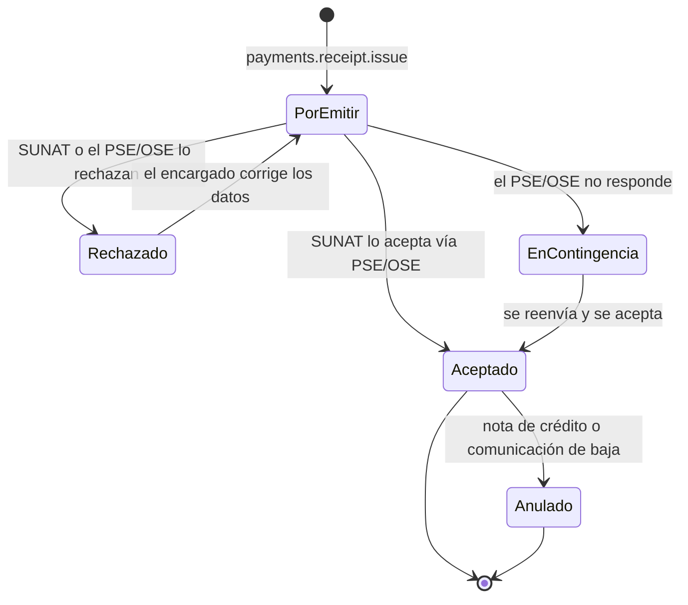

# Módulo: Pagos y comprobantes

Estado: fase 1, diseño. Cobro digital, saldo a favor, propinas y comprobantes SUNAT. Requiere Sala; habilita el modo Directo de Mesa digital ([ADR 0009](../../adr/0009-licencias-y-activacion-de-modulos.md)). Reglas de negocio: [pagos y comprobantes](pagos-y-comprobantes.md). Decisiones: [ADR 0005](../../adr/0005-piloto-peru-pagos-y-comprobantes.md), [ADR 0008](../../adr/0008-pasarela-propia-de-cada-restaurante.md).

## Responsabilidades
- **Cobrar** a cada grupo con la pasarela propia del restaurante, mediante un **adaptador por pasarela**.
- Generar el **QR o link de pago** que el mesero muestra cuando no hay Mesa digital (R23).
- **Propina** sugerida por grupo (10% por defecto, editable por local).
- Llevar el **saldo a favor** de cada grupo y descontarlo de los siguientes pedidos (R18).
- **Reembolsar** al medio original el saldo que quede al cerrar el grupo.
- **Emitir comprobantes** SUNAT (boleta o factura) mediante un **adaptador de PSE/OSE**, y enviarlos al destino que elija el cliente (R12).
- Guardar cifradas las **credenciales** de la pasarela y del PSE/OSE de cada local; nunca se versionan.
- **Conciliar** con la pasarela: confirmar por webhook y, si no llega, por consulta de estado.

No le corresponde: llevar la cuenta del grupo (la lleva Sala), registrar pagos por fuera (los registra el mesero en Sala) ni enviar la venta al sistema de caja (también Sala, [ADR 0007](../../adr/0007-ventas-al-sistema-de-caja.md)).

## Requisitos
R12, R18, R19, R23. Ver [requisitos](../../plataforma/requisitos.md).

## Contratos
| Con | Pagos envía | Pagos recibe |
|---|---|---|
| Sala | pago confirmado o rechazado, saldo del grupo, reembolso hecho o fallido, comprobante emitido o fallido | cargo por grupo, solicitud de QR o link de pago, ajustes que generan saldo a favor, pagos por fuera y descuentos (para el comprobante), solicitud de emisión al liquidar |
| Mesa digital | datos para pagar (según la pasarela), pago confirmado o rechazado, saldo a favor, comprobante emitido | solicitud de cobro con propina, RUC si pide factura, destino del comprobante |
| Personal | propinas por grupo y medio | — |
| Cuenta de cliente (futuro) | comprobantes del cliente | identidad del cliente, tarjeta guardada en la pasarela |
| Núcleo | auditoría de cobros, reembolsos y anulaciones | configuración del local: pasarela, PSE/OSE, % de propina, datos del emisor (RUC, razón social, series) |
| Pasarela externa (adaptador) | cobro, reembolso, consulta de estado | webhook con el resultado |
| PSE/OSE externo (adaptador) | comprobante a emitir | aceptación o rechazo de SUNAT, PDF y XML |

Mensajes concretos: [eventos y comandos](../../plataforma/eventos.md#pagos-y-comprobantes-payments). Qué hace Pagos cuando falta cada módulo opcional: [dependencias](../../plataforma/dependencias.md#pagos-y-comprobantes).

## Dinero
- Moneda del piloto: **PEN**. Los montos se guardan como **enteros en céntimos**, nunca con decimales flotantes.
- Los precios de la carta ya incluyen IGV ([Núcleo](../nucleo/README.md)). El comprobante desglosa base e IGV a partir del total.
- La propina **no forma parte** de la base imponible del comprobante; viaja aparte en el pago y en el envío al sistema de caja.

## Máquinas de estado
Cada cambio de estado se publica como evento ([eventos](../../plataforma/eventos.md)). Estados del grupo y de la sesión: [sesión de mesa](../sala/sesion-de-mesa.md#estados-de-un-grupo).

### Pago
Un pago es un intento de cobro a un grupo por un monto. Si falla, el cliente reintenta con un pago nuevo.

- **Aprobado** se decide solo con la confirmación de la pasarela (webhook verificado o consulta de estado), nunca con lo que diga la PWA.
- **Vencimiento:** 15 min para el cobro en la PWA y 30 min para el QR o link del mesero, configurable por local.
- **Pendiente sin webhook:** a los 2 min se consulta el estado a la pasarela, y luego cada minuto hasta que venza.
- Eventos: `payments.payment.succeeded` (Aprobado) y `payments.payment.failed` (Rechazado, Expirado o Anulado, con `reason`).

### Saldo a favor
No es una máquina de estado, sino un saldo por grupo:
- **Suma** con `payments.adjustment.create` (ítem pagado y luego cancelado o editado a menos).
- **Resta** cuando se aplica a un pedido o adición nueva del grupo; si cubre todo, el pedido se confirma sin pasar por la pasarela.
- Al liquidar el grupo, lo que quede se reembolsa.
- Evento: `payments.credit.changed`.

### Reembolso

- El saldo se reembolsa en orden inverso a los pagos del grupo (primero el más reciente), sin superar lo cobrado en cada uno.
- **Fallido** alerta al encargado (R16: siempre hay vía humana).
- Eventos: `payments.refund.completed` y `payments.refund.failed`.

### Comprobante

- **Rechazado** suele deberse a un RUC inválido o a datos del emisor mal configurados. Se alerta al encargado.
- **EnContingencia:** la serie y el número ya están asignados; se reintenta en segundo plano y, cuando se acepta, se envía al destino elegido. **Propuesta por confirmar:** el grupo puede cerrarse aunque su comprobante esté en contingencia (ver [preguntas abiertas](../../preguntas-abiertas.md)).
- **Anulado:** solo lo hace el encargado, con motivo, y queda en la auditoría.
- Eventos: `payments.receipt.issued` (Aceptado) y `payments.receipt.failed` (Rechazado o EnContingencia, con `reason`).

## Adaptador de pasarela
Un adaptador por pasarela (Culqi, Izipay, Niubiz, Mercado Pago…) con el mismo contrato ([ADR 0008](../../adr/0008-pasarela-propia-de-cada-restaurante.md)). El resto del módulo no conoce a ninguna pasarela por su nombre.

| Operación | Entrada | Salida | Notas |
|---|---|---|---|
| `capabilities` | — | medios soportados (card, yape, plin, apple_pay, google_pay), si admite reembolso parcial, si admite QR o link | La PWA solo muestra estos medios |
| `createCharge` | `idempotency_key`, `amount`, `currency`, `description`, `return_url`, `expires_at` | `provider_ref`, datos para pagar (URL, token o QR) | Repetir con la misma clave devuelve el mismo cobro |
| `getChargeStatus` | `provider_ref` | `pending`, `approved`, `rejected` o `expired`, con el medio usado | Para conciliar sin webhook |
| `refund` | `idempotency_key`, `provider_ref`, `amount` | `refund_ref`, estado | Monto parcial o total |
| `getRefundStatus` | `refund_ref` | `pending`, `completed` o `failed` | |
| `parseWebhook` | cabeceras y cuerpo crudos | evento normalizado (`provider_ref`, nuevo estado) | **Verifica la firma**; si no es válida, lo descarta |

Reglas comunes:
- Las credenciales de cada local se leen cifradas en tiempo de ejecución; el adaptador nunca las registra en logs.
- Hungría **no guarda datos de tarjeta**: el cliente los ingresa en el formulario o SDK de la pasarela.
- Los errores se traducen a un conjunto común (`declined`, `insufficient_funds`, `expired`, `provider_unavailable`, `invalid_config`) para que la PWA muestre el mismo mensaje con cualquier pasarela.

## Adaptador de PSE/OSE
Mismo patrón para el proveedor de comprobantes, que todavía no se ha elegido.

| Operación | Entrada | Salida |
|---|---|---|
| `issue` | `idempotency_key`, tipo (boleta o factura), serie, ítems con base e IGV, total, cliente (DNI o RUC opcional, razón social) | estado (accepted, rejected, pending), número, PDF y XML |
| `getStatus` | serie y número | estado ante SUNAT |
| `void` | serie y número, motivo | nota de crédito o comunicación de baja |
| `validateTaxId` | RUC | razón social y si está activo, para validar la factura en la PWA |

## Seguridad y conciliación
- Todo cobro y reembolso lleva una **clave de idempotencia** derivada de `payment_id` o `refund_id`, para que un reintento no cobre dos veces.
- Los eventos se entregan **al menos una vez** ([ADR 0010](../../adr/0010-eventos-y-comandos.md)); los consumidores descartan los duplicados por ID.
- **Conciliación diaria** por local: se comparan los pagos aprobados en Hungría con los de la pasarela y se alerta al encargado si hay diferencias.
- **Sin red** ([ADR 0006](../../adr/0006-operacion-sin-red.md)): no hay cobro digital y se cobra por fuera. Los comprobantes pendientes se emiten al volver la red.

## Degradación
Qué hace Pagos cuando falta cada módulo opcional: [dependencias](../../plataforma/dependencias.md#pagos-y-comprobantes).
