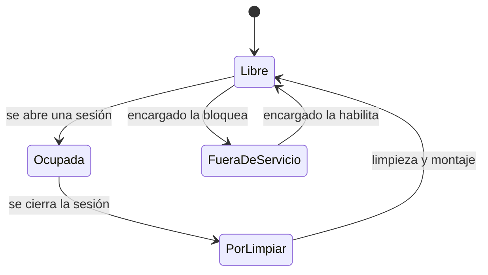
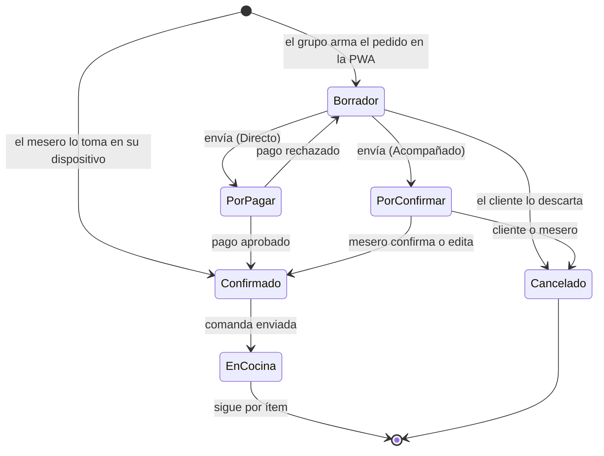
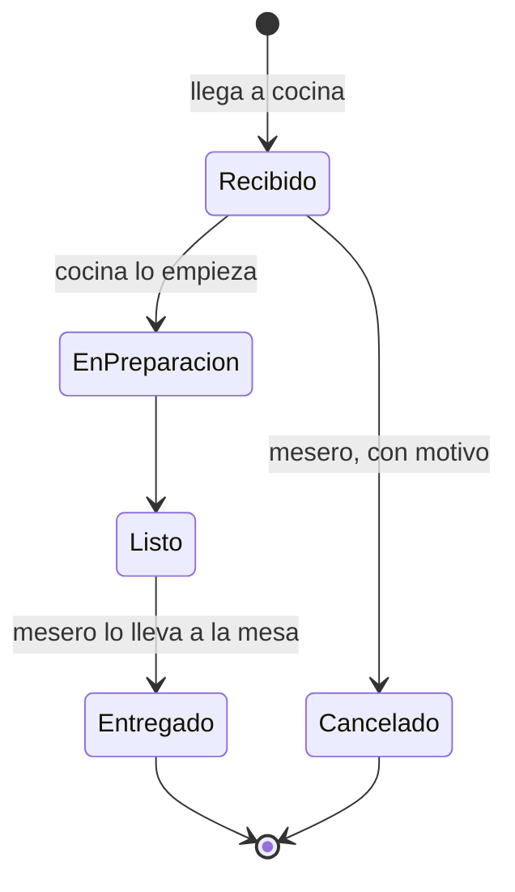
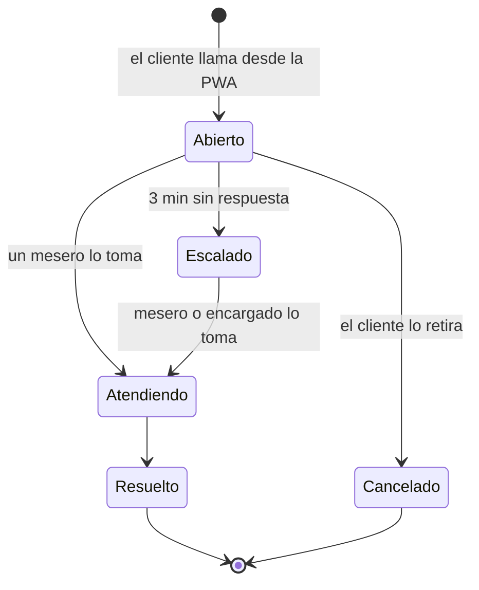

# Máquinas de estado

Estados de las entidades de Sala, Mesa digital y Cocina. Los de la sesión y el grupo están en [sesión de mesa](sesion-de-mesa.md). Cada cambio de estado se publica como evento ([eventos](../../plataforma/eventos.md)).

## Mesa (Núcleo)

- Al unir mesas, todas quedan **Ocupada** bajo una sola sesión; al cerrarla, todas pasan a **PorLimpiar**.
- Evento: `core.table.status_changed`.

## Pedido (Sala)
Un pedido es lo que un grupo envía de una vez. Su recorrido hasta cocina depende del modo y de quién lo arma.

- Las alergias y notas se revisan antes de pasar a **Confirmado** (R5).
- Desde **EnCocina**, cada ítem sigue su propio estado.

## Ítem del pedido (Cocina)

- **Cancelar:** solo hasta **Recibido**. Desde **EnPreparacion** el ítem se cobra (R25).
- **Solo impresora:** si la cocina no usa pantalla, la comanda impresa cuenta como **EnPreparacion**.
- **Pagado en Directo y cancelado:** el monto queda como saldo a favor del grupo (R18).
- **Demora:** si un ítem no llega a **Listo** dentro del tiempo fijo del local (configurable, por ejemplo 20 min) desde **Recibido**, se emite `kitchen.item.delayed` y se alerta al mesero (R27). No cambia de estado.
- Evento: `kitchen.item.status_changed`.

## Llamado (Sala)

- **Abierto:** avisa al mesero de la zona, o a todos los meseros del local sin Personal.
- **Escalado:** a los 3 minutos (configurable por local) alerta también al encargado (R26).
- Eventos: `tableside.call.requested`, `floor.call.escalated`, `floor.call.answered`.
