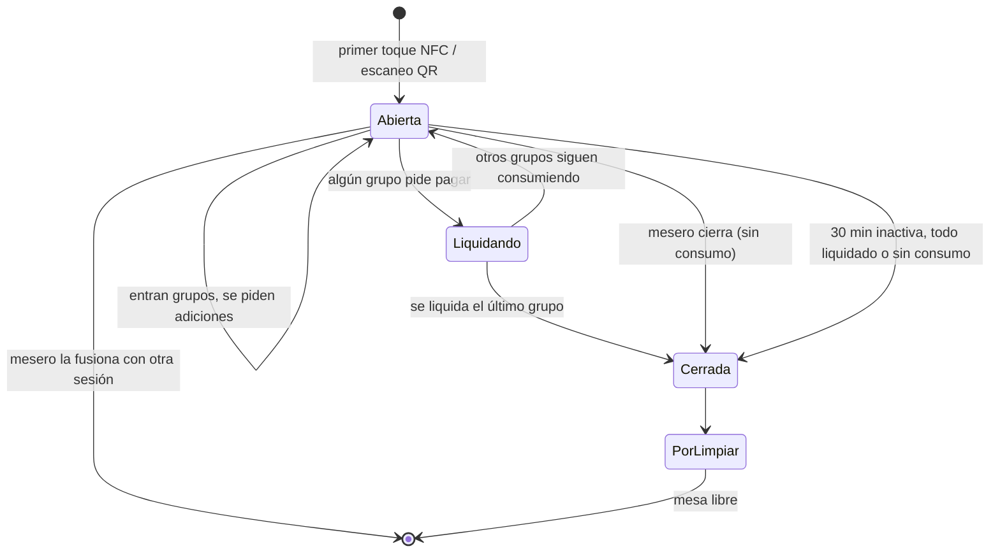
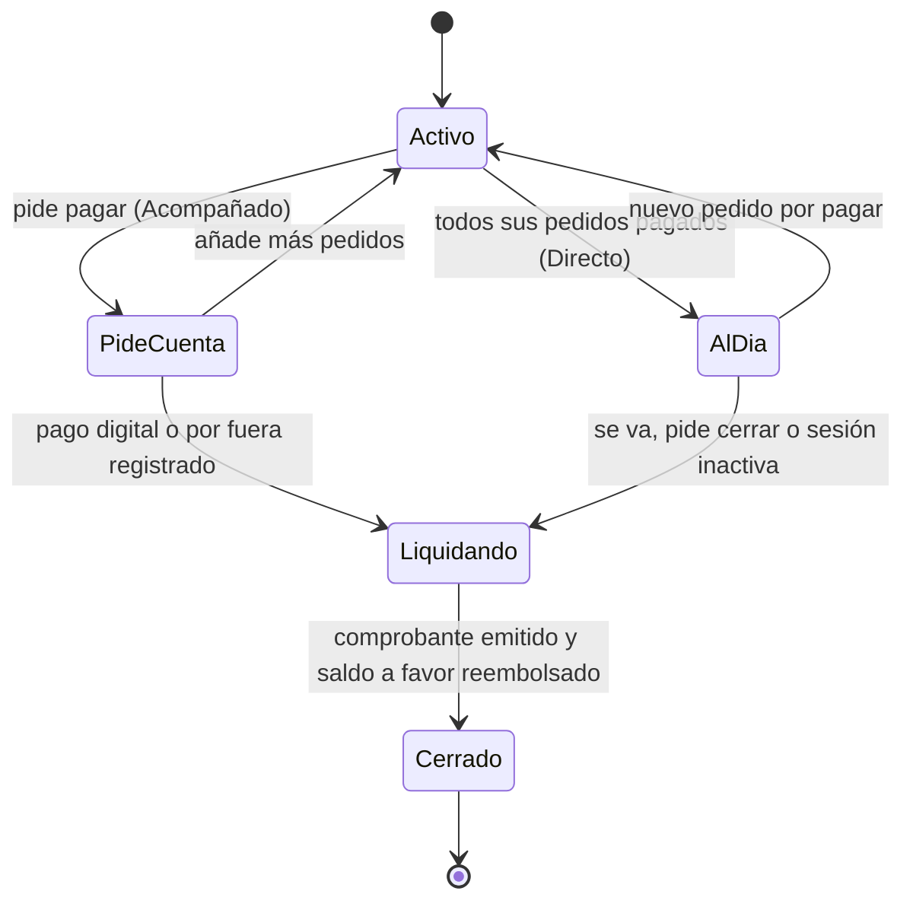

# Sesión de mesa

Modelo central del módulo de atención al cliente. Decisión: [ADR 0003](../../adr/0003-sesion-de-mesa-con-grupos.md).

## Entidades
| Entidad | Definición |
|---|---|
| **Sesión de mesa** | Contenedor de todo lo que ocurre en una mesa física. Se abre con el primer toque NFC o escaneo QR ([acceso](../mesa-digital/acceso-a-la-mesa.md)). |
| **Grupo** | Un **titular** más sus **invitados vinculados**. Tiene cuenta, pago y comprobantes propios. |
| **Titular** | Comensal que arma el pedido del grupo y paga por él. |
| **Invitado vinculado** | Comensal que el titular aceptó explícitamente; sus pedidos se cargan al grupo del titular. |
| **Comensal solo** | Grupo de una persona; se crea automáticamente al entrar. No es un caso especial. |

No hay un titular único de mesa: una sesión puede tener varios grupos.

## Identidad
Cada usuario recibe un nombre anónimo de animal (gato, chancho, perro, ballena, cocodrilo...) que es visible para los demás de la sesión. No se pide registro para usar la sesión. La interfaz es una PWA en español e inglés; no hay app nativa en esta fase.

## Reglas
1. **Vincular es explícito.** El titular acepta a cada invitado de forma individual y consciente; ver quién se acepta es parte de la interfaz. Evita que un actor malicioso se cuelgue de una cuenta.
2. **Un comensal pertenece a un solo grupo a la vez.** Cambiar de grupo requiere aceptación del grupo destino.
3. **Llegada tardía:** quien llega a una mesa ya abierta puede crear su propio grupo o pedir unirse a uno existente (el grupo lo acepta o rechaza).
4. **Platos compartidos** se cargan a **un solo grupo** (un único pago). El mesero puede reasignarlos.
5. **El mesero puede editar los pedidos de la mesa** en ambos [modos de servicio](../mesa-digital/modos-de-servicio.md), hasta que la cocina empieza cada ítem; desde ahí el ítem se cobra ([estados](estados.md)). También puede expulsar a un participante.
6. **Se puede añadir comida en cualquier momento.** Cada adición genera un nuevo flujo de pago según el modo.
7. **Cada grupo se liquida por su cuenta** y puede irse cuando quiera.
8. **Cierre por inactividad:** tras **30 minutos** sin actividad, la sesión se cierra sola si todos sus grupos están liquidados o si no hubo consumo. Con cuentas pendientes no se cierra; se avisa al mesero.
9. **Sin límite de grupos ni usuarios** por sesión por defecto. El restaurante puede fijar un máximo por configuración.
10. **Unir y dividir mesas:** al unir, el mesero fusiona las sesiones: una absorbe a la otra y los grupos se conservan. Al dividir, el mesero mueve grupos a la sesión de la otra mesa.

## Estados de la sesión

## Estados de un grupo

- **AlDia** (Directo): el grupo no debe nada y puede seguir pidiendo. El comprobante se emite una sola vez, al liquidarse, con todos sus pagos.
- **Liquidando:** se emite el comprobante del grupo y se reembolsa el saldo a favor que quede ([pagos](../pagos/pagos-y-comprobantes.md)).
- Estados de mesa, pedido, ítem y llamado: [máquinas de estado](estados.md).

## Cierre
La sesión cierra cuando se liquida el **último** grupo; la mesa pasa a "por limpiar" y luego a libre. Se emite un comprobante **por grupo** ([pagos y comprobantes](../pagos/pagos-y-comprobantes.md)).

## Qué toca el mesero
Ver todos los grupos de su zona, confirmar pedidos (modo Acompañado), editar, mover ítems entre grupos, registrar pagos por fuera, expulsar participantes y fusionar o dividir sesiones al unir o separar mesas. La tecnología nunca elimina esta vía humana.
